<picture>
  <source media="(max-width: 600px)" srcset="https://github.com/VniiD/VniiD/raw/refs/heads/output/profile-cover-mobile.svg">
  
</picture>

 
"Não entre em pânico."(ADAMS)
 
 
 

## Engenharia de software começa antes do código

 

-  **Arquitetura pragmática:** monólito modular, eventos ou serviços independentes, conforme latência, consistência, escala e custo. Padrões servem ao problema, não o contrário.
-  **Fundamentos de sistemas:** memória, CPU, rede, I/O e concorrência ajudam a explicar o comportamento do software, não só a sintaxe.
-  **Segurança desde o desenho:** confidencialidade, integridade, disponibilidade, confiabilidade, rastreabilidade e não repúdio orientam requisitos e validações. ISO/IEC 27001 é referência, não alegação de certificação. Segredos e chaves não entram no código.
-  **IA sob revisão:** acelera tarefas; decisões de arquitetura, segurança e validação continuam humanas.

**Objetivo:** Engenharia de Software e Tecnologia em grandes bancos e fintechs, com foco em back-end e System Design, do requisito à operação.

 
 

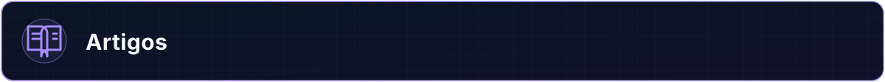

 

-  **00 — [Engenharia sem atalhos](https://www.linkedin.com/pulse/engenharia-sem-atalhos-do-ch%C3%A3o-de-f%C3%A1brica-%C3%A0-era-da-ia-ferreira-cjq7f/)** 
  Fundamentos de computação, engenharia pragmática e responsabilidade na era da IA.
-  **01 — [Arquitetura, modelagem e governança](https://www.linkedin.com/pulse/arquitetura-modelagem-e-governan%C3%A7a-na-era-da-ia-vinicius-ferreira-uzpbf/)** 
  Requisitos, modelo C4, trade-offs e contratos antes da implementação.
-  **02 — [Security by Design](https://www.linkedin.com/pulse/security-design-blindagem-e-frameworks-corporativos-na-ferreira-3yjrf/)** 
  Segurança no ciclo de desenvolvimento, na arquitetura e na cadeia de dependências.

 
 

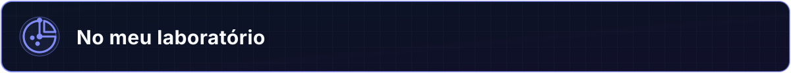

 
 

             
             

 
 

 
 
 

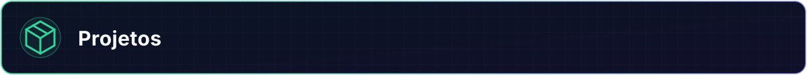

 

  <a href="https://github.com/VniiD/Push_Swap">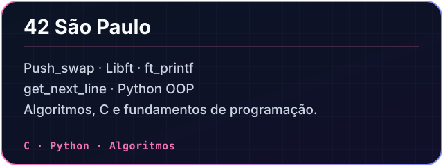</a>
  <a href="https://github.com/VniiD/.Net_Fundamentos">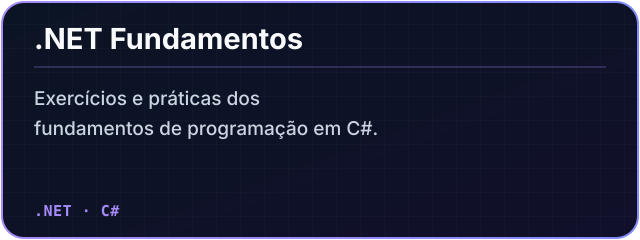</a> 
  <a href="https://github.com/VniiD/SplitPay">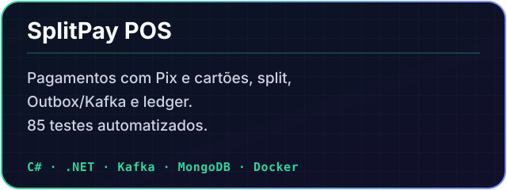</a>
  <a href="https://github.com/VniiD/split-payment-platform">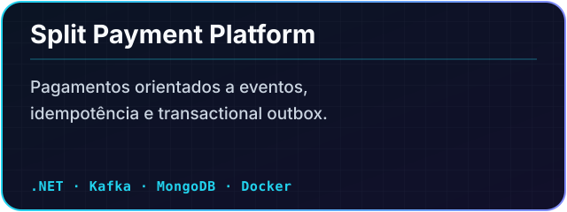</a>
   
  <a href="https://github.com/VniiD/Hackathon_Marlabs_XP_G7">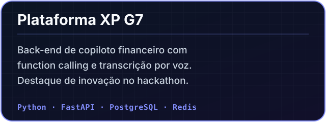</a>
  <a href="https://github.com/VniiD/A_maze_ing">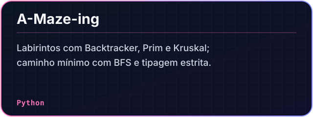</a>
   
  <a href="https://github.com/VniiD/PIXCore">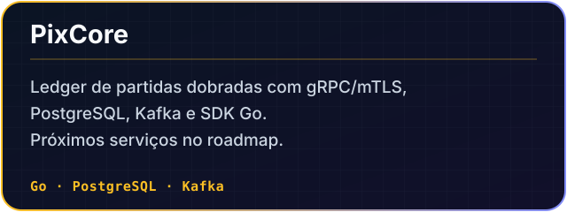</a>

 
 

 

-  **Engenharia de Software, UniCesumar** — 6º semestre, cursando. Conclusão prevista para dezembro de 2027.
-  **Análise e Desenvolvimento de Sistemas, UniCesumar** — concluído em 2026.
-  **Gestão da Tecnologia da Informação, UniCesumar** — concluída em 2026, simultaneamente a ADS.
-  **42 São Paulo, formação de desenvolvedor** — Cadete no Common Core V2, Piscine aprovada e Missão Python concluída a 100%.

<h3> <big><h2>Cursos</h2></big></h3>

-  **Cisco** — Introdução à Cibersegurança, Networking Basics e Python Essentials 1.
-  **DIO** — Data Analytics com Python. Cursando Developer .NET/C#, APIs e Azure.
-  **Google / Coursera** — Google Cybersecurity Certificate, 7 de 9 módulos.
-  **ENAP** — Análise de Dados em R.

 
 

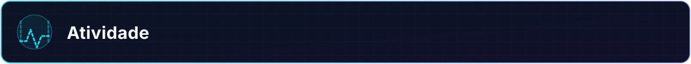

 

