<picture>
  <source media="(max-width: 600px)" srcset="https://raw.githubusercontent.com/VniiD/VniiD/output/profile-cover-mobile.svg">
  
</picture>

## Engenharia de software começa antes do código

Transformo problemas de negócio em serviços back-end confiáveis. Primeiro entendo as regras e os riscos. Depois defino limites, contratos e arquitetura. A tecnologia vem para resolver o problema, não para criar outro.

-  **Arquitetura pragmática:** monólito modular, eventos ou serviços independentes, conforme latência, consistência, escala e custo. Padrões servem ao problema, não o contrário.
-  **Fundamentos de sistemas:** memória, CPU, rede, I/O e concorrência ajudam a explicar o comportamento do software, não só a sintaxe.
-  **Segurança desde o desenho:** confidencialidade, integridade, disponibilidade, confiabilidade, rastreabilidade e não repúdio orientam requisitos e validações. ISO/IEC 27001 é referência, não alegação de certificação. Segredos e chaves não entram no código.
-  **IA sob revisão:** acelera tarefas; decisões de arquitetura, segurança e validação continuam humanas.

**Objetivo:** estágio ou trainee em Engenharia de Software e Tecnologia em grandes bancos e fintechs, com foco em back-end e System Design, do requisito à operação.

###   Atividade · Mapa do código

<h2> Artigos <small>Arquitetura · Governança · Sistemas distribuídos · Segurança</small></h2>

-  **00 · [Engenharia sem atalhos](https://www.linkedin.com/pulse/engenharia-sem-atalhos-do-ch%C3%A3o-de-f%C3%A1brica-%C3%A0-era-da-ia-ferreira-cjq7f/)** 
  Fundamentos de computação, engenharia pragmática e responsabilidade na era da IA.
-  **01 · [Arquitetura, modelagem e governança](https://www.linkedin.com/pulse/arquitetura-modelagem-e-governan%C3%A7a-na-era-da-ia-vinicius-ferreira-uzpbf/)** 
  Requisitos, modelo C4, trade-offs e contratos antes da implementação.
-  **02 · [Security by Design](https://www.linkedin.com/pulse/security-design-blindagem-e-frameworks-corporativos-na-ferreira-3yjrf/)** 
  Segurança no ciclo de desenvolvimento, na arquitetura e na cadeia de dependências.

###  No meu laboratório

  <strong>BACK-END · DADOS · MENSAGERIA · INFRAESTRUTURA</strong>  
    
    
  <strong>EM DESENVOLVIMENTO</strong>  
  
    
  <strong>OUTROS FUNDAMENTOS E PLATAFORMAS</strong>  
  

###  Projetos

### <a href="https://github.com/VniiD/SplitPay">SplitPay POS</a>

Pagamentos com Pix e cartões, split, Outbox/Kafka e ledger. **85 testes automatizados.**

### <a href="https://github.com/VniiD/split-payment-platform">Split Payment Platform</a>

Pagamentos orientados a eventos, idempotência e transactional outbox.

### <a href="https://github.com/VniiD/Hackathon_Marlabs_XP_G7">Plataforma XP G7</a>

Liderei o back-end de um copiloto financeiro com function calling e transcrição por voz. Destaque de inovação no hackathon.

### <a href="https://github.com/VniiD/A_maze_ing">A-Maze-ing</a>

Labirintos com Backtracker, Prim e Kruskal; caminho mínimo com BFS e tipagem estrita.

### <a href="https://github.com/VniiD/PIXCore">PixCore</a>

Ledger de partidas dobradas com gRPC/mTLS, PostgreSQL, Kafka e SDK Go. O ledger está implementado; os próximos serviços estão no roadmap.

###  Fundamentos · 42 São Paulo

- **[Push_swap](https://github.com/VniiD/Push_Swap)** · 660 operações para 100 números, 4.930 para 500.
- **[Libft](https://github.com/VniiD/Libft)** · reimplementação de funções da libc em C.
- **[ft_printf](https://github.com/VniiD/Printf)** · formatação variádica e baixo nível.
- **[get_next_line](https://github.com/VniiD/Get_Next_Line)** · leitura incremental e gestão de memória.
- [`.NET Fundamentos`](https://github.com/VniiD/.Net_Fundamentos) · [Python OOP](https://github.com/VniiD/Python42SP)

<h2> Formação</h2>

-  **Engenharia de Software, UniCesumar** · 6º semestre, cursando. Conclusão prevista para dezembro de 2027.
-  **Análise e Desenvolvimento de Sistemas, UniCesumar** · concluído em 2026.
-  **Gestão da Tecnologia da Informação, UniCesumar** · concluída em 2026, simultaneamente a ADS.
-  **42 São Paulo, formação de desenvolvedor** · Cadete no Common Core V2, Piscine aprovada e Missão Python concluída a 100%.

<h2> Cursos</h2>

-  **Cisco** · Introdução à Cibersegurança, Networking Basics e Python Essentials 1.
-  **DIO** · Data Analytics com Python. Cursando Developer .NET/C#, APIs e Azure.
-  **Google / Coursera** · Google Cybersecurity Certificate, 7 de 9 módulos.
-  **ENAP** · Análise de Dados em R.
